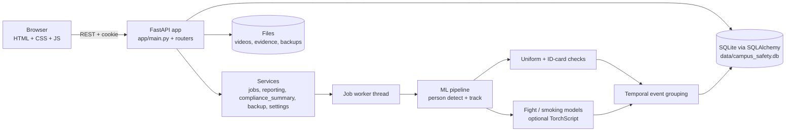
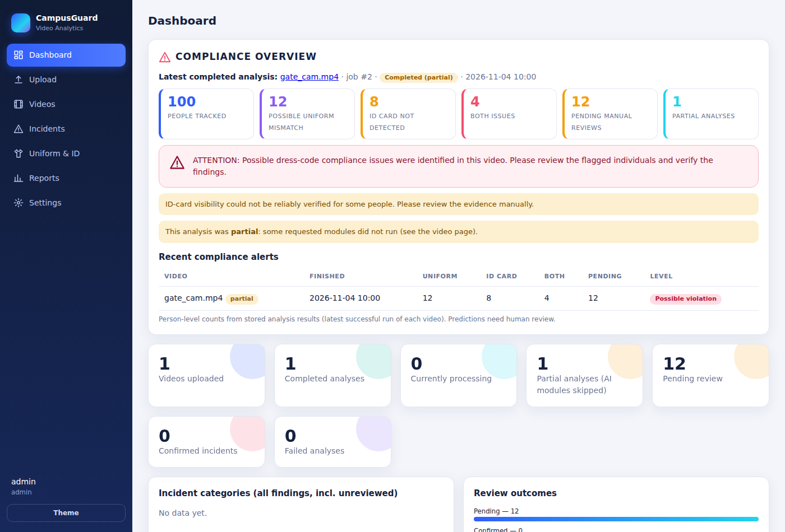
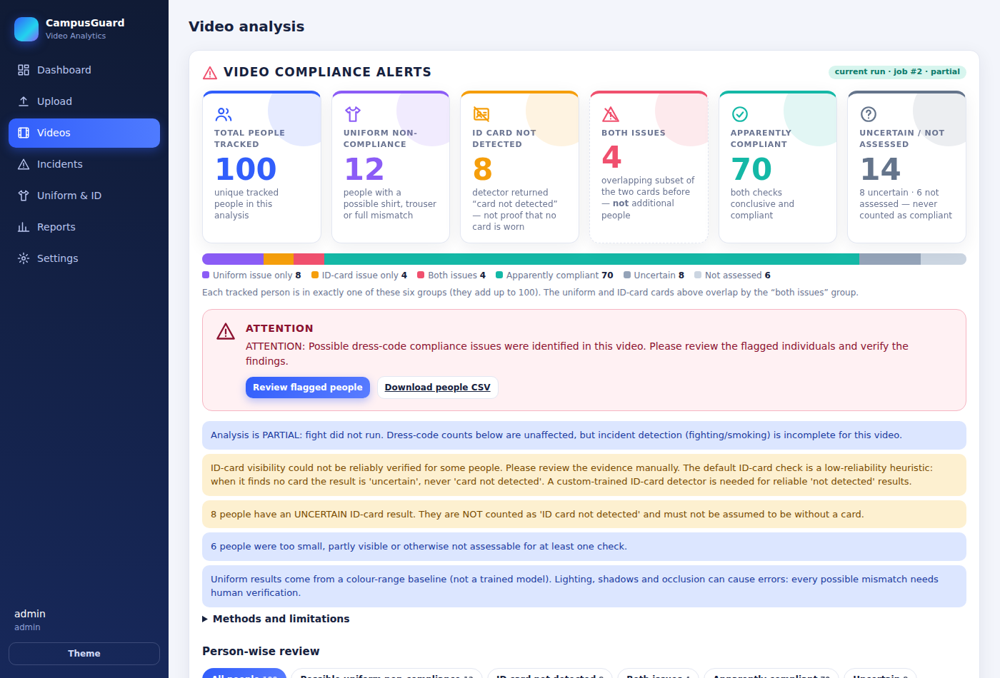
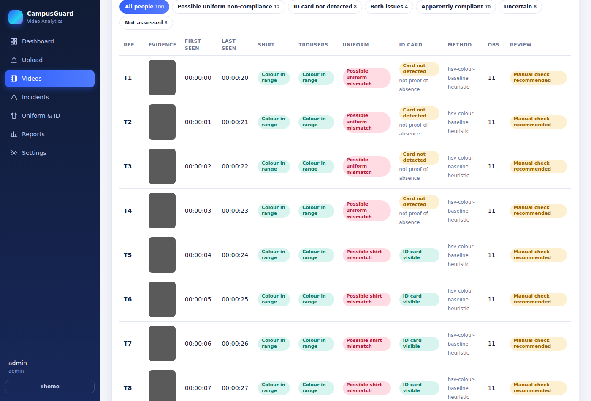
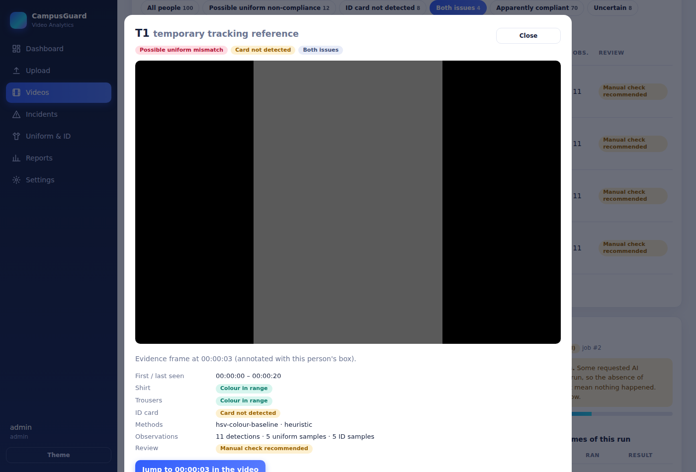

# CampusGuard

**AI-Based Video Surveillance Analytics for Campus Safety and Dress-Code Compliance**


CampusGuard is a B.Tech CSE project. A reviewer uploads CCTV footage; the system analyses it in the background, tracks people, checks **uniform** and **ID-card visibility**,
optionally recognises **fighting** and **smoking**, stores every finding with a timestamp and evidence image, and lets a human **confirm or dismiss** each finding before it appears in
PDF/CSV reports. **The AI assists a human reviewer; it never declares anyone guilty, and it does not identify people.**

> **Status in one paragraph (v1.4.0).** Upload, background analysis, person detection/tracking (OpenCV fallback), the uniform colour baseline, the ID-card heuristic, the video-level
> compliance alerts, review workflow, evidence storage, reports, database persistence, backups and migrations are implemented. **Fighting and smoking recognition are *not configured*:
> no trained model ships with the project and none has been evaluated** (see [docs/ML_STATUS.md](docs/ML_STATUS.md)). The Windows `.exe` must be built on Windows
> (`build_exe.ps1`) and the public hosted deployment is prepared but not deployed. [TESTING_REPORT.md](TESTING_REPORT.md) lists exactly what was and was not executed.

---
## Table of contents
1. [Objectives](#1-objectives) · 2. [Features](#2-main-features) · 3. [Technology stack](#3-technology-stack) · 4. [Architecture](#4-system-architecture) · 5. [Frontend & backend](#5-frontend-and-backend) ·
6. [Database](#6-database-architecture) · 7. [ML algorithms](#7-machine-learning-components) · 8. [Datasets](#8-datasets) · 9. [Requirements](#9-installation-requirements) · 10. [Windows setup](#10-windows-setup) ·
11. [Run](#11-running-the-application) · 12. [Login](#12-login) · 13. [Upload & analyse](#13-uploading-and-analysing-a-video) · 14. [Review](#14-reviewing-incidents) · 15. [Reports](#15-generating-reports) ·
16. [Compliance alerts](#16-video-compliance-alerts) · 17. [Screenshots](#17-screenshots) · 18. [Testing](#18-testing-and-evaluation-results) · 19. [Limitations](#19-known-limitations) ·
20. [Security & privacy](#20-security-and-privacy) · 21. [Windows .exe](#21-windows-executable) · 22. [Public deployment](#22-public-deployment) · 23. [Future work](#23-future-enhancements) ·
24. [Repository, licence, acknowledgements](#24-repository-licence-and-acknowledgements) · [Troubleshooting](#troubleshooting)

## 1. Objectives
1. Reduce the manual effort of watching CCTV footage by **finding candidate moments** (possible uniform non-compliance, ID card not visible, fighting, smoking).
2. Keep a **human in the loop**: every finding is a *prediction* that must be reviewed, with the review history stored.
3. Be **honest about uncertainty**: "uncertain" and "not assessed" are first-class results and are never reported as compliant.
4. Run **locally**, with all data kept in one SQLite file plus evidence files, and survive restarts without losing data.

## 2. Main features
| Capability | State out of the box |
|---|---|
| Authentication, roles (admin/reviewer), audit log | Working (login optional in local mode, mandatory when hosted) |
| Video upload with validation, background jobs, cancel/reprocess, playback, timeline | Working |
| Person detection | OpenCV HOG fallback works with no downloads (weak); YOLO + ByteTrack when optional ML files are present |
| Person tracking | IoU tracker (fallback) / ByteTrack; IDs are temporary labels (T1, T2 ...), not identities |
| Uniform check (beige shirt, navy trousers) | Working colour-range **baseline**, shirt and trousers judged separately, "uncertain"/"unable to verify" states. **Unevaluated** |
| ID-card / lanyard visibility | Low-reliability heuristic (a miss is *uncertain*, never "not detected") or a custom YOLO model you train. **Unevaluated** |
| Video-level **compliance alerts** and in-app notifications | Working (v1.3) - see [section 16](#16-video-compliance-alerts) |
| Fighting / smoking recognition | **Not configured** - no weights ship; never produces random output |
| Incident review (confirm / dismiss / inconclusive) with notes | Working |
| Evidence images/clips, PDF + CSV reports, backups, migrations, retention | Working |
| Membership verification | Interface only - always "unverified"; **no face recognition** |

## 3. Technology stack
| Layer | Technology | Purpose |
|---|---|---|
| Language | Python 3.10-3.12 | Backend and ML pipeline |
| Web API | FastAPI + Uvicorn + Pydantic | REST endpoints, validation, server |
| Database | SQLite + SQLAlchemy 2 (+ plain-`sqlite3` migrations) | Persistent storage |
| Computer vision | OpenCV, NumPy | Decoding, HOG detector, colour analysis, evidence images |
| ML tooling | Pandas, scikit-learn (training scripts only) | Dataset splitting, optional classifier training |
| Optional ML | PyTorch, torchvision, Ultralytics YOLO | YOLO detection/ByteTrack, action recognition (AGPL note: [THIRD_PARTY_NOTICES.md](THIRD_PARTY_NOTICES.md)) |
| Reports | ReportLab, `csv` | PDF and CSV |
| Frontend | HTML, CSS, vanilla JavaScript, Chart.js (CDN) | Single-page interface (no framework) |
| Packaging | PyInstaller (build time), PowerShell scripts | Windows executable and setup |
| Tests | pytest, HTTPX/TestClient, Node.js, Playwright (offline checks) | Automated testing |
| Deployment | Docker + Caddy (prepared) | Optional HTTPS hosting |

## 4. System architecture

Upload is streamed to disk and validated; the HTTP request returns immediately while one worker thread analyses the video (frames are sampled, never loaded fully into RAM).
Detail: [docs/ARCHITECTURE.md](docs/ARCHITECTURE.md).

## 5. Frontend and backend
* **Frontend** (`app/static/`): one `index.html`, `css/styles.css`, `js/app.js`. Pages: Dashboard (compliance overview + statistics), Upload, Videos (player, timeline, compliance alerts),
  Incidents (review), Uniform & ID, Reports, Settings. A watcher polls `/api/jobs` every 4 s to raise a completion notification exactly once per finished job.
* **Backend** (`app/`): `routers/` (auth, videos, events, reports, system, compliance), `services/` (jobs, reporting, compliance_summary, runs, backup, model_status, settings_service),
  `ml/` (pipeline, person, uniform, idcard, activity, events, registry), `models.py`, `database.py`, `migrations.py`, `security.py`, `config.py`.
* **Launcher** (`launcher.py`): starts the app for the Windows executable.

## 6. Database architecture
SQLite file `data/campus_safety.db` (or `%LOCALAPPDATA%\CampusGuard\data\` in the .exe), WAL mode, foreign keys on. Key tables: `videos`, `analysis_jobs` (one row per run), `job_modules`,
`tracked_people`, `track_observations`, `events`, `evidence` (relative file paths), `reviews` (immutable history), `model_evaluations`, `users`, `session_tokens`, `settings`, `audit_log`, `schema_version`.
Runs are never overwritten: the latest successful run is "current" and older runs stay in history. Migrations back the database up first and never drop data.
Details: [docs/DATABASE.md](docs/DATABASE.md).
```powershell
.\.venv\Scripts\python scripts\backup_db.py                              # verified backup (also a button in Settings)
.\.venv\Scripts\python scripts\restore_db.py data\backups\<file>.db        # validates only; STOP THE SERVER first
.\.venv\Scripts\python scripts\restore_db.py data\backups\<file>.db --yes  # restores (current DB is kept as pre_restore_*.db)
```
A backup copies the database only; copy `data\videos` and `data\evidence` too if you need the footage.

## 7. Machine-learning components
| Component | Method | State |
|---|---|---|
| Person detection | OpenCV HOG + SVM (default) or YOLOv8n (optional) | HOG works; YOLO needs weights you download |
| Tracking | IoU association tracker or ByteTrack | Working |
| Uniform | HSV colour-range analysis on shirt/trouser regions, majority vote over samples; optional learned colour classifier | Baseline works, **no accuracy known** |
| ID card | Geometric heuristic on the chest area, or custom YOLO detector | Heuristic is low reliability; **custom model not trained** |
| Fighting, smoking | TorchScript video classifiers (e.g. R3D-18) over 4-s windows + temporal rules (min hits, min duration, merge gap) | **Not configured** |
Methodology, thresholds and the reproducible training/evaluation procedure: [docs/ML_METHODOLOGY.md](docs/ML_METHODOLOGY.md), [docs/TRAINING.md](docs/TRAINING.md), [docs/ML_STATUS.md](docs/ML_STATUS.md).
**No accuracy figure is claimed anywhere; the app shows "Not evaluated" until a real held-out evaluation is stored.**

## 8. Datasets
Candidate datasets (COCO, CrowdHuman, MOTChallenge, UCF101, HMDB51, Kinetics, RWF-2000, UCF-Crime, Violent-Flows) with links, licences, access rules and the
hard negatives to include are in **[docs/DATASETS.md](docs/DATASETS.md)**. No dataset or model weights are bundled.

## 9. Installation requirements
Windows 10/11 64-bit, **Python 3.10-3.12** (not 3.13), about 1 GB free disk (more for videos), optional FFmpeg (`winget install Gyan.FFmpeg`) for AVI/MOV preview and evidence clips.
A GPU is not required.

## 10. Windows setup
```powershell
cd CampusGuard
powershell -ExecutionPolicy Bypass -File .\setup.ps1            # venv + requirements + .env    (add -WithML for the optional PyTorch/YOLO stack)
```
Manual equivalent:
```powershell
py -3.12 -m venv .venv
.\.venv\Scripts\python -m pip install -r requirements.txt
copy .env.example .env
```
No Python? Use the [Windows executable](#21-windows-executable) instead. Full guide: [docs/INSTALLATION_GUIDE.md](docs/INSTALLATION_GUIDE.md).

## 11. Running the application
```powershell
powershell -ExecutionPolicy Bypass -File .\run.ps1      # opens http://127.0.0.1:8000
```
Equivalent: `.\.venv\Scripts\python -m uvicorn app.main:app --host 127.0.0.1 --port 8000`. Stop with Ctrl+C.

**Upgrading from an earlier version (keeps all data):** stop the server, **copy your `data` folder somewhere safe**, extract the new version over the project folder (`data/`, `.env`, `.venv` are not in the ZIP so they are untouched)
and run `run.ps1`. An older database is backed up to `data\backups\pre_migration_v*.db` and migrated automatically; nothing is dropped (see `CHANGELOG.md`).

## 12. Login
* **Local mode (default):** no sign-in screen; you land on the dashboard as the administrator. The server listens on `127.0.0.1` only.
* **Login required** (use this whenever others can reach the app): add `CAMPUS_REQUIRE_LOGIN=true` to `.env`. The administrator account is created on first start: set
  `ADMIN_USERNAME`/`ADMIN_PASSWORD` in `.env`, otherwise a random password is printed **once** in the console. No credentials are stored in this repository.
  Lost it: `.\.venv\Scripts\python scripts\reset_admin_password.py`. Admins add reviewers via `POST /api/auth/users`.

## 13. Uploading and analysing a video
1. **Upload** page -> choose an MP4/AVI/MOV (validated: extension, container signature, decodability, duration 5 s-90 min, size up to 4 GB; limits are in Settings), keep *start analysis* ticked.
   For a plumbing test without real footage: `.\.venv\Scripts\python scripts\make_demo_video.py`.
2. **Videos -> open the video**: progress bar, Cancel/Reprocess, timeline. When the job ends a notification appears and the **Video compliance alerts** section fills in.
3. A job without all models finishes as **Completed (partial)**; the module table shows which modules ran and which were *not assessed*.

## 14. Reviewing incidents
**Incidents** page: filter by date/video/category/status, open a finding, watch the clip or evidence frames, then **Confirm / Dismiss / Inconclusive** with notes.
Every decision is stored immutably in `reviews` and the audit log. Reports count only **confirmed** events as incidents. **Uniform & ID** shows per-person results with evidence.

## 15. Generating reports
**Reports** page: set filters, then download **PDF** (includes the *Video-level uniform and ID-card compliance summary*, model states and limitations), **CSV** (events) or
**compliance CSV (people)** (one row per tracked person). All content is read from the database.

## 16. Video compliance alerts
After each analysis the **VIDEO COMPLIANCE ALERTS** section shows person-level counts for *that run*: total tracked, possible uniform non-compliance, ID card not detected, both issues
(an overlapping subset - never add the three), apparently compliant, uncertain, not assessed; six exclusive groups always sum to the total. **"ID card not detected" appears only when the detector actually returned it**;
the default heuristic never does, so you will normally see an honest "could not be reliably verified" warning instead. Full rules: [docs/COMPLIANCE.md](docs/COMPLIANCE.md).

## 17. Screenshots
> The screenshots use **synthetic demonstration data** (a 100-person scenario served by a mock backend), not real footage and not results from a trained model.

| | |
|---|---|
|  |  |
|  |  |

## 18. Testing and evaluation results
**Read [TESTING_REPORT.md](TESTING_REPORT.md).** Summary of the release build:

| Area | Result |
|---|---|
| Compliance counting logic, PDF section, CSV, launcher logic, notification logic, browser UI (mock backend) | **Executed - passed** (`tests/standalone/`) |
| Full pytest suite (115 tests: API, DB, migrations, e2e, ML, compliance, packaging) | **Written, NOT executed** in the release environment (no web stack/internet). Run `run_tests.ps1` |
| Windows .exe, hosted deployment, GitHub push | **Not built / not deployed / not pushed** in the release environment |
| Accuracy (uniform, ID, fighting, smoking) | **Not measured. No precision/recall/F1 exist.** Procedure in [docs/ML_STATUS.md](docs/ML_STATUS.md) |

## 19. Known limitations
* No fighting/smoking models; HOG fallback misses small, seated or partly hidden people; the ID heuristic cannot say "not detected"; the colour baseline is sensitive to lighting, white balance, bags/lanyards covering the torso and near-white shirts.
* Whole-frame action models are not attributed to an individual. "Total people" counts *tracks*; one person can produce several.
* Single worker thread; SQLite suits one server instance. No accuracy is claimed; human review is mandatory.
* The .exe is unsigned (Windows SmartScreen warning) and must be built on Windows.

## 20. Security and privacy
Passwords PBKDF2-SHA256; session token (hashed in the DB) in an HttpOnly SameSite=Lax cookie; login throttling; same-origin check on writes; path-traversal-safe file serving; auth on all video/evidence/report endpoints;
upload validation; audit log; retention settings. **Local mode has no password and must stay on `127.0.0.1`.** For any network use set `CAMPUS_REQUIRE_LOGIN=true`, `COOKIE_SECURE=true` and put it behind HTTPS
([docs/DEPLOYMENT.md](docs/DEPLOYMENT.md)). CCTV of people is personal data: get institutional approval, restrict access, set retention, never commit footage/databases (the `.gitignore` blocks them).
No facial recognition; tracking IDs are temporary labels.

## 21. Windows executable
Build on Windows (PyInstaller cannot cross-compile): `powershell -ExecutionPolicy Bypass -File .\build_exe.ps1` -> `dist\CampusGuard\CampusGuard.exe`; the script then runs the exe's own `--selftest`.
The exe stores data in `%LOCALAPPDATA%\CampusGuard`, opens your browser, shows readable start-up errors and stops from **Quit CampusGuard** / Ctrl+C. It does not contain PyTorch/YOLO.
**No pre-built exe is stored in this repository's source ZIP.** Two ways to get one without owning a Windows build setup:
1. Push the project to GitHub; the workflow `.github/workflows/build-windows-exe.yml` builds it on a GitHub Windows machine, runs the same self-test, and offers `CampusGuard_Windows.zip`
   under *Actions -> Build Windows executable -> Artifacts* (or under *Releases* when you push a version tag).
2. Build it yourself with `build_exe.ps1`. Only a build whose self-test prints `SELF-TEST PASSED` should be shared.

## 22. Public deployment
Local exe (one PC) and a central hosted app (many browsers) are different things: see [docs/DEPLOYMENT.md](docs/DEPLOYMENT.md) for the comparison, hosting evaluation (free tiers are unsuitable for CCTV),
the Docker + Caddy HTTPS setup and the go-live checklist. **Not deployed yet.**

## 23. Future enhancements
Train and evaluate fighting/smoking models on licensed data; train a custom ID-card detector; collect labelled campus crops to evaluate the uniform check; per-person (not whole-frame) action recognition;
PostgreSQL + Alembic for multi-instance hosting (needs approval); code-signing the exe; multi-camera/live RTSP input; role-based camera/area permissions.

## 24. Repository, licence and acknowledgements
* **GitHub repository:** `https://github.com/<your-username>/CampusGuard` - `scripts/publish_to_github.ps1` creates it and replaces `<your-username>` with your account name automatically (see [docs/PUBLISH_TO_GITHUB.md](docs/PUBLISH_TO_GITHUB.md)). Until you run it, no repository exists.
* **Licence:** MIT for this project's code ([LICENSE](LICENSE)). Third-party licences, including the AGPL-3.0 note for optional Ultralytics: [THIRD_PARTY_NOTICES.md](THIRD_PARTY_NOTICES.md).
* **Acknowledgements:** FastAPI, Starlette, Uvicorn, SQLAlchemy, OpenCV, NumPy, ReportLab, Chart.js, the dataset authors listed in [docs/DATASETS.md](docs/DATASETS.md), and the faculty mentor.

## Troubleshooting
| Problem | Fix |
|---|---|
| `setup.ps1` says Python not found | Install 3.10-3.12 (3.13 wheels for the pinned NumPy/OpenCV may not exist) |
| `pip install` fails on opencv/numpy | `python -m pip install --upgrade pip`; make sure the venv is 64-bit Python 3.10-3.12 |
| Video will not play in the browser | Needs H.264 MP4; install FFmpeg so AVI/MOV get a preview copy |
| "Model not configured" | Expected until you add weights ([models/README.md](models/README.md)) |
| `ultralytics`/`torch` import errors | They are optional; the HOG fallback works. See Settings -> Model availability |
| Port 8000 busy | `uvicorn app.main:app --port 8010` (the .exe picks a free port automatically) |
| Locked out (login mode) | `scripts\reset_admin_password.py` |
| .exe will not start | Read `%LOCALAPPDATA%\CampusGuard\logs\startup_error.log` and `campusguard.log` |
